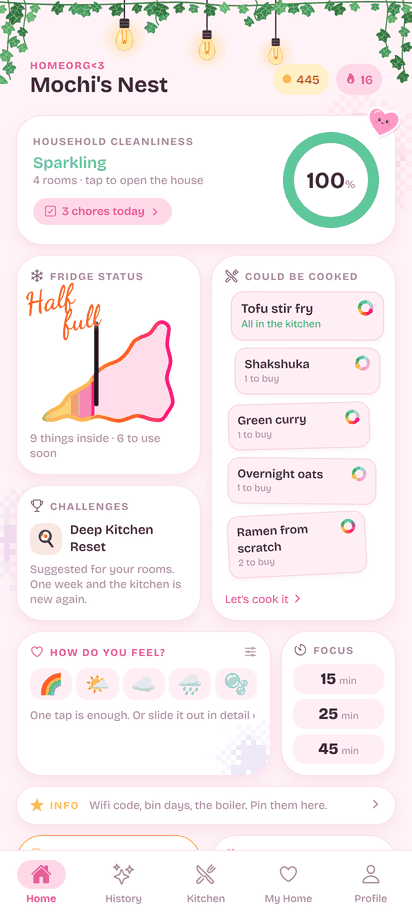
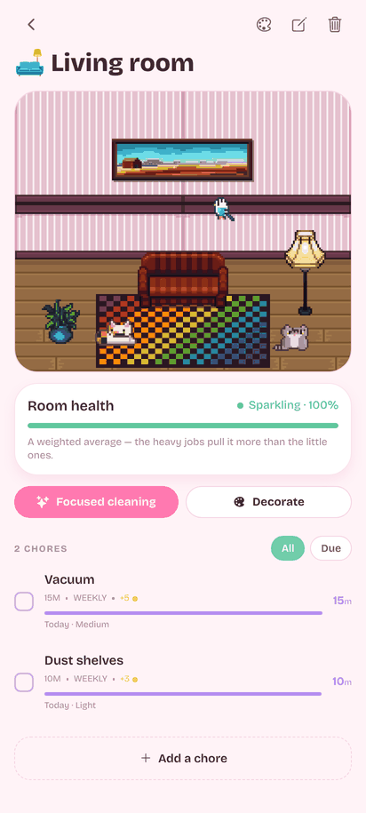
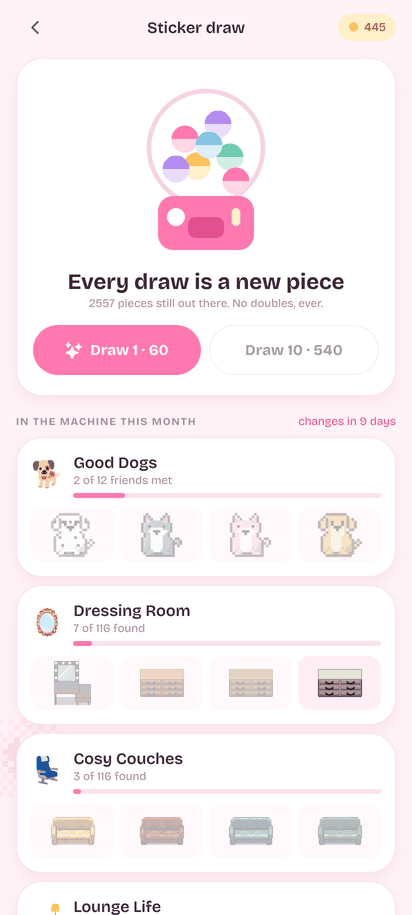
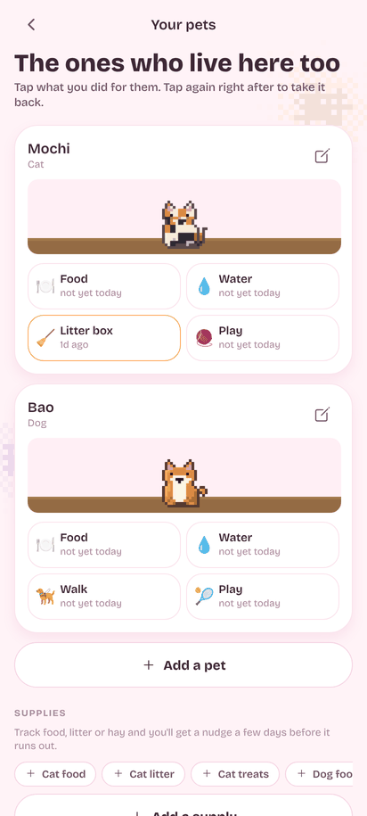

<div align="center">


<a href="docs/media/homeorg.mp4"></a>

<sub>▶ Mit Ton ansehen: <a href="docs/media/homeorg.mp4">homeorg.mp4</a></sub>

# Homeorg<3

**Putzen, Kochen, Haustiere – und ein kleines Pixel-Zuhause, das mit dir gemütlicher wird.**


</div>

> [!WARNING]
> **🚧 Baustelle.** Homeorg<3 wird gerade kräftig umgebaut: neue Pixel-Zimmer,
> Haustiere, iPhone-Build. Es läuft schon jeden Tag auf echten Handys, aber
> Sachen können sich ändern, ruckeln oder kurz kaputtgehen. Mach ab und zu ein
> Backup (*Einstellungen → Export data*).

---

## ✨ Was drin ist

|  |  |
| --- | --- |
| 🧽 **Putzen ohne Druck** | Jede Aufgabe hat ihren Rhythmus. *Heute* packt nur so viel in den Tag, wie in dein Zeitbudget passt – leichte Sachen zuerst, damit du in Schwung kommst. |
| 🪙 **Münzen für alles** | Putzen, Kochen, Einräumen, Haustier versorgen, Einchecken: alles gibt Münzen, mit Tageslimit pro Quelle. |
| 🏠 **Dein Pixel-Zuhause** | Jedes Zimmer ist ein kleines Pixel-Bild mit Tapete und Boden zur Wahl. Möbel und Deko klebst du als Sticker hin – frei schieben, drehen, spiegeln, stapeln. |
| 🎰 **Sticker-Automat** | Rund 2 600 Pixel-Teile in 27 Sets, jeden Monat drei Möbel-Sets und ein Tier-Set im Automaten. Jede Ziehung ist neu. **Keine In-App-Käufe. Niemals.** |
| 🐈 **Haustier-Modus** | Katze, Hund, Vogel, Fisch, Hamster, Gecko …: ein Tipp für Futter, Wasser, Katzenklo, Gassi oder Wasserwechsel, dazu Vorräte mit Reichweite in Tagen. |
| 🍳 **Küche** | Rezeptbuch, „Let's cook it“, Vorrat mit Mindesthaltbarkeit, Einkaufsliste. REWE-Bestellungen und eBons räumen sich selbst ein. |
| 🔖 **Nicht vergessen** | Was weg muss, was bald abläuft, ein leerer Kühlschrank, Katzenstreu, die zur Neige geht – an einer Stelle, sanft statt nervig. |
| 💗 **Wie geht's dir?** | Kurz einchecken. An schweren Tagen gibt es liebe Worte und weniger Aufgaben, nie mehr – und mit Haustier einen Kuschel-Vorschlag. |
| 🌸 **Kawaii** | Rosa Papier, Efeu, Glühbirnen, Sticker mit Gesichtern, Pixel-Kleckse. Fünf weitere Farbschemata, von Classic bis Midnight. |

## 📸 So sieht's aus

<div align="center">
<table>
  <tr>
    <td></td>
    <td></td>
    <td></td>
    <td></td>
  </tr>
  <tr>
    <td align="center"><sub>Home</sub></td>
    <td align="center"><sub>Ein Zimmer</sub></td>
    <td align="center"><sub>Sticker-Automat</sub></td>
    <td align="center"><sub>Haustiere</sub></td>
  </tr>
</table>
</div>

## 📲 Installieren

**Android:** Die APK aus den [Releases](../../releases) aufs Handy laden, antippen,
„Installation aus unbekannter Quelle“ erlauben. Läuft auf jedem 64-Bit-Android
(etwa ab 2017).

**iPhone:** Ohne App Store, per Sideload. Die `.ipa` aus den Releases mit
SideStore, AltStore oder Sideloadly und deiner eigenen Apple-ID installieren.
Braucht iOS 16.4 oder neuer. Die Details stehen [unten](#iphone-sideloaden).

**Nur mal reinschauen:** `npm install && npm run web` öffnet die App im Browser
(ohne Kamera und Haptik).

## 🔒 Privat, ganz ehrlich

Alles liegt auf dem Handy. Kein Konto, kein Server, keine Synchronisation,
keine Werbung, keine Analyse. Die einzige Netzverbindung ist die abschaltbare
Barcode-Suche bei Open Food Facts, und die schickt nur die Nummer vom Karton.
PDFs und Fotos werden auf dem Gerät gelesen und nie hochgeladen.

---

## 🛠️ Für Entwickler:innen

Wer am Code arbeitet (Mensch oder KI-Agent), liest zuerst [AGENTS.md](AGENTS.md).

<details>
<summary><b>Starten, testen, bauen</b></summary>

```bash
npm install
npx expo start          # QR-Code mit Expo Go scannen (gleiches WLAN, sonst --tunnel)
npm run web             # im Browser
npm run tsc             # Typprüfung
npm test                # REWE, Haltbarkeit, GS1, Datumsscan, Sticker, Streaks, Check-ins, Haustiere
npm run apk             # Release-APK lokal (JDK 21 + Android SDK 36)
```

### APK selbst bauen

Läuft komplett auf dem eigenen Rechner – kein Expo-Konto, nichts wird
hochgeladen. `scripts/build-apk.js` sucht JDK und SDK selbst zusammen.
`npm run apk` erzeugt die nativen Projektdateien, trägt den Signierschlüssel
ein und baut; die Datei landet in
`android/app/build/outputs/apk/release/app-release.apk`.

Gebaut wird nur für **arm64-v8a**; für ein altes 32-Bit-Gerät einmalig
`TIDYWELL_ABIS=armeabi-v7a,arm64-v8a npm run apk`. Der erste Build lädt rund
1,6 GB Gradle-Abhängigkeiten und dauert eine Viertelstunde, danach gut eine Minute.

**Der Signierschlüssel liegt in `credentials/` und gehört nicht ins Git.**
Ohne ihn lässt sich eine installierte Version nicht mehr aktualisieren.
`npx expo prebuild` überschreibt `android/` komplett; `scripts/sign-android.js`
setzt die Signierung danach neu, `npm run apk` erledigt das mit.

### Über GitHub bauen lassen

Ein Tag wie `v1.3.0` pushen: Der Workflow *Release* baut die APK und die IPA
und hängt beide an ein GitHub-Release. Unter *Actions → Release → Run workflow*
geht es auch ohne Release, wahlweise nur für Android oder nur für iOS. Für die
eigene Android-Signatur braucht das Repo vier Secrets – siehe
[AGENTS.md](AGENTS.md#git-and-releases).

### iPhone (sideloaden)

Der Workflow baut eine **unsignierte IPA** auf einem kostenlosen macOS-Rechner
von GitHub, kein eigener Mac nötig. Signiert wird beim Installieren mit deiner
Apple-ID:

1. IPA herunterladen (Release oder Workflow-Artefakt).
2. Mit **SideStore**, **AltStore** oder **Sideloadly** installieren.
3. Auf dem iPhone *Einstellungen → Datenschutz & Sicherheit → Entwicklermodus*
   einschalten und dem Entwickler unter *Allgemein → VPN & Geräteverwaltung*
   vertrauen.

Mit einer **kostenlosen Apple-ID** läuft die App 7 Tage und muss dann
aufgefrischt werden (SideStore/AltStore machen das im WLAN), höchstens 3 Apps
gleichzeitig. Mit dem **Apple Developer Program** (99 €/Jahr) hält die Signatur
ein Jahr. Daten bleiben beim Auffrischen erhalten. Die Erinnerungen sind lokale
Benachrichtigungen; die Push-Berechtigung, die eine kostenlose Apple-ID nicht
signieren kann, nimmt der Workflow heraus. Mindestens iOS 16.4.

### EAS

`eas.json` liegt dabei, falls du lieber bei Expo in der Cloud baust
(`eas build -p android --profile preview`). Dafür brauchst du ein Expo-Konto,
und das Projekt samt Musik wandert auf fremde Server.

</details>

<details>
<summary><b>Wie es funktioniert</b></summary>

**Sauberkeit** Jede Aufgabe hat eine Frequenz. Von 100 % (gerade geputzt) läuft
eine Linie auf 0 % (ein voller Zyklus vorbei), bei jedem Öffnen neu gerechnet.
Monate sind echte Monate: 31. Januar + 1 Monat = 28. Februar.

**Reihenfolge** Wie überfällig und wie leicht. Überfällig zählt mehr, aber
leichte Aufgaben bekommen einen Bonus: Fünf kleine Erfolge bauen die Energie für
den großen auf. Irgendwann hört „überfällig“ auf zu wachsen.

**Raum-Prozent** Ein nach Minuten gewichteter Durchschnitt. Ein sauberer Spiegel
rettet keinen dreckigen Boden.

**Heute** Ein Zeitbudget pro Tag (Standard 30 Min), gefüllt mit dem
Dringendsten; der Rest wartet in „Got more time?“. Abgehakte Aufgaben zählen
gegen das Budget, damit der Tag auch mal endet.

**Münzen und Streaks** Münzen für Aufgaben (3/5/10 nach Aufwand) und fast alles
andere, mit Tageslimit pro Quelle (`src/lib/rewards.ts`). Streaks zählen jeden
aktiven Tag im selbst gewählten Rhythmus (täglich, alle 2–3 Tage, wöchentlich)
mit Schonfrist.

**Zimmer** Jedes Zimmer ist ein Pixel-Bild in 3/4-Draufsicht: Tapete und Boden
aus LPC-Kacheln (rund 250 Tapeten und 150 Böden, je mit rosa Variante), darauf
Sticker. Neue Zimmer kommen mit ein paar passenden Pixel-Möbeln.

**Sticker-Automat** Jede Ziehung ist ein Teil, das du noch nicht hast, aus den
Sets des Monats. Erst wird das Set gewählt, dann das Teil nach Seltenheit.

**Haustiere** Pflege-Tipps je Tierart (`src/lib/pets.ts`), ein zweiter Tipp
innerhalb von zehn Minuten nimmt den ersten zurück. Vorräte laufen nach
Tagesverbrauch ab und melden sich fünf Tage vorher.

**Küche** *Rezepte* ist eine Sammlung, kein Wochenplan. Homeorg<3 hält sie gegen
den Vorrat: was sofort ginge, wo ein, zwei Sachen fehlen. „Cooked it“ zieht die
Zutaten ab, der Einkaufsknopf schickt nur das Fehlende auf die Liste.

**Musik** Startet in Focus und bei Sprints und läuft im Hintergrund weiter.

</details>

<details>
<summary><b>Barcode, REWE, Haltbarkeit</b></summary>

**Barcode scannen** Im Vorrat: Kamera drauf, Name und Packungsgröße kommen von
[Open Food Facts](https://world.openfoodfacts.org). Die einzige Stelle, an der
die App ins Netz geht; abschaltbar unter *Einstellungen → Look barcodes up online*.

**REWE-Bestellung einräumen** Das PDF zur Abholung/Lieferung oder den **eBon**
wählen; die App liest es auf dem Handy. Gezählt wird die Liefermenge, Ersatzartikel
kommen als das, was wirklich in der Tüte war, lose Ware mit echtem Gewicht. Aus
Kassenkürzeln wie `KRAEUT.SEITL.BIO` wird „Kräuterseitlinge bio“.
`npm run test:rewe` prüft gegen echte (anonymisierte) Bestellungen in `scripts/fixtures/`.

**Haltbarkeit** Alles im Vorrat bekommt ein Mindesthaltbarkeitsdatum: vom Etikett
(**Scan date** liest es per Kamera mit Google ML Kit – MHD, SKT, 賞味期限,
有效日期, 유통기한 …), aus dem QR-/DataMatrix-Code (GS1), oder geschätzt nach
Lagerort – eigene Tabelle, dann USDA FoodKeeper (CC0), dann Open-Food-Facts-Kategorien.
Geschätzte Daten stehen mit „≈“ da. Die Texterkennung ist nativ: in der APK ja,
in Expo Go und im Browser nicht.

</details>

<details>
<summary><b>Aufbau</b></summary>

```
app/                 Screens (expo-router, dateibasiert)
  (tabs)/            Home, History, Today, My Home, Profile
  room/ task/ challenge/ decorate/ recipe/
  kitchen.tsx cook.tsx recipes.tsx shopping.tsx   die Küche
  pets.tsx           Haustiere und Vorräte
  shop.tsx           der Sticker-Automat
  scan.tsx import.tsx Barcode scannen, REWE-Bestellung einräumen
src/
  lib/               reine Logik: Planung, Daten, PDF, REWE, Sticker, Haustiere, Erinnerungen
  state/             Zustand (zustand + AsyncStorage), abgeleitete Werte
  data/              Raumtypen, Sticker-Katalog, Wände/Böden, Challenges, Einheiten
  ui/                Bausteine, RoomCanvas, StickerLayer, Deko, Pixel-Kleckse
assets/stickers/     Pixel-Sticker (generiert)
assets/surfaces/     Tapeten und Böden (generiert)
assets/music/        die Musik
scripts/
  build-stickers.py  Sticker aus LPC-Bögen schneiden, Haustiere rendern
  build-surfaces.py  Tapeten und Böden schneiden
  pets/              die selbst gezeichneten Haustiere (Vorlagen, Fell, Arten)
  build-apk.js sign-android.js  APK bauen und signieren
```

Sticker neu bauen: `python3 scripts/build-stickers.py` (braucht Pillow);
Wände und Böden: `python3 scripts/build-surfaces.py`;
Musik: `TIDYWELL_MUSIC_SRC="D:/pfad/zu/Music" npm run music`.

</details>

<details>
<summary><b>Daten sichern</b></summary>

**Einstellungen → Export data** schreibt alles in eine Datei
`homeorg-backup-JJJJ-MM-TT.json` und öffnet das Teilen-Menü. **Import data**
liest so eine Datei wieder ein und ersetzt dabei alles (vorher wird gefragt).
Vorher-/Nachher-Fotos bleiben auf dem Gerät. Die Datei trägt eine
Formatversion, damit spätere Versionen ältere Sicherungen lesen können.

</details>

<details>
<summary><b>Was fehlt (mit Absicht)</b></summary>

Homeorg<3 begann als lokaler Nachbau der App von tidywell-app.com, ohne alles,
was einen Server braucht:

- Haushalt teilen, Mitglieder, Rollen, Kinder-Modus
- Live-Sprints zu mehreren (Solo-Sprint ist drin)
- Foto-Sync zwischen Geräten

Die Aufgabenzerlegung läuft regelbasiert auf dem Gerät. Alles ist freigeschaltet –
ein Abo ohne Server wäre sinnlos.

</details>

## 💗 Credits

- **Pixel-Möbel, Wände und Böden:** [LPC Revised](https://github.com/ElizaWy/LPC)
  (CC-BY 3.0 / OGA-BY 3.0), Künstler:innen pro Set im About-Screen und in
  `assets/stickers/CREDITS.md`.
- **Haustiere:** für diese App gezeichnet (`scripts/pets/`).
- **Produktdaten:** [Open Food Facts](https://world.openfoodfacts.org) (ODbL).
  **Haltbarkeit:** USDA FoodKeeper (CC0).
- **Musik:** aus der eigenen Bibliothek, neu kodiert. Die NCS-Titel sind für so
  etwas freigegeben, die Spiele-Soundtracks normalerweise nicht – vor einem
  Store-Release müsste die Musik raus oder durch lizenzfreie ersetzt werden.
- **Das Video oben** ist mit [/brag](https://github.com/latent-spaces/brag)
  entstanden; der Soundtrack darin ist eigens erzeugt.
